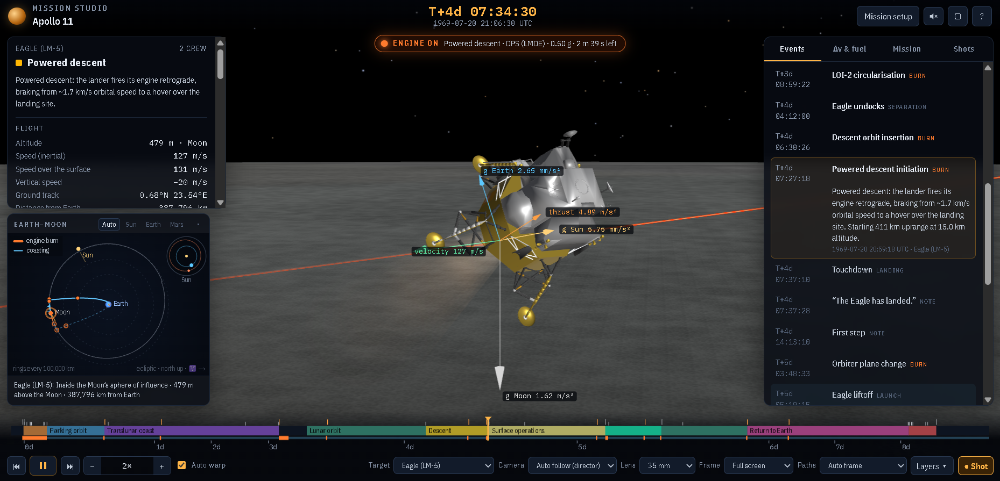

# MISSION STUDIO — offline mirror

Full mirror of **Mission Studio — Space Shuttle, Moon & Mars**, a Cloudflare
Pages deploy served under the `/apps/mission-studio/` sub-path.

Source: https://sanghyunpark.pages.dev/apps/mission-studio/



## Stack

- **One self-contained HTML file + a hashed asset tree** — the entry document
  (`apps/mission-studio/index.html`, 1,151,899 B) carries the whole app in
  three inline blocks: one inline `<style>` (31,286 B, a single deliberate dark
  theme) and two inline scripts — a classic `<script id="engine-src">`
  (399,856 B, the simulation engine: constants/vector math, JPL ephemerides,
  Kepler solver, RK4 integrator, launch-vehicle models, flight phases,
  timeline, planner, lunar/LEO/interplanetary mission design) and an ES module
  `<script type="module">` (700,066 B, the three.js renderer + UI). The engine
  is also the Worker source: the app clones its own text into a `Blob` and
  runs it in a Web Worker for mission planning.
- **three.js r160, vendored by the deploy** — the module imports
  `./assets/three.module.min.3e690ac7d1.js` (670,681 B, `REVISION` 160,
  MIT), plus the same-origin `assets/GLTFLoader.<hash>.js`,
  `assets/BufferGeometryUtils.<hash>.js` and
  `assets/meshopt_decoder.module.<hash>.js` addons. All captured byte-exact.
- **Runtime asset map** — the module's `ASSET_MAP` maps 31 logical names to
  hashed deploy filenames (`assets/<name>.<hash>.<ext>`): six GLB models
  (Saturn V, Shuttle stack, ISS, Orion/orbiter, Apollo LM, Perseverance),
  18 planet texture JPGs (Earth day/night/clouds/aux at 2K + 8K, Moon, Mars
  at 2K/4K/8K + aux, Jupiter, Saturn, Venus), three orbiter-patch WebPs and a
  `stars.json` star catalog. Closure was iterated to fixpoint over the
  captured code and cross-checked with a live browser network log while the
  app ran — every on-origin request resolves inside the capture.
- **External (not captured, CDN rule)** — the Google Fonts stylesheet
  (IBM Plex Mono / IBM Plex Sans Condensed) and its `fonts.gstatic.com`
  files stay external exactly as served; the app falls back to system fonts
  offline. Sound is synthesized WebAudio (no audio files); the favicon is an
  inline `data:` SVG.

## What this is

Mission Studio (sanghyunpark.pages.dev/apps/mission-studio/) — “3D mission
simulator — Space Shuttle, Moon and Mars — with real launch vehicles, solved
trajectories, live telemetry and storyboard capture.” Pick a missions
scenario (e.g. Apollo 11, Artemis, a Mars transfer), configure the stack
(Saturn V, Shuttle, a Mars ascent vehicle), then fly it: the engine solves the
trajectory (patched-conic lunar design with an n-body refinement, Lambert
interplanetary legs) and the three.js view renders the Earth/Moon/Mars system
with real ephemerides, the vehicle in flight, live telemetry, and a
storyboard capture tool. The whole simulator is the two inline scripts.

The capture is **33 files, 55,868,895 bytes**: the entry document plus 32
hashed files under `assets/` (the three.js module, three three.js addons,
six GLB models, 18 JPG textures, three WebP patches, one JSON star catalog).
All captured byte-exact; the served `/apps/mission-studio/` path structure is
preserved at the repo root.

## Layout

- `apps/mission-studio/` — the served sub-path, byte-exact (open
  `apps/mission-studio/index.html` through any static server)
- `.upstream/manifest.json` — sha256 for every captured file (33 files)
- `readable/` — prettified derived layer (pinned prettier 3.9.6) for the
  three inline blocks and the four captured vendor modules
- `src/` + `split-spec.json` — statement-aligned slices of the two inline
  scripts with the recorded derivation spec
- `tools/derive.mjs` — rebuild `readable/` + `src/` + `split-spec.json`
- `tools/update.mjs` — read-only drift probe against the live deploy
- `tools/verify.mjs` — re-hash the capture against the manifest
- `tools/audit.js` — integrity gate for the derived layers (`AUDIT PASS`)
- `tools/serve.mjs` — loopback static server used for the boot test

## Assets

- **models** — 6 file(s): `apps/mission-studio/assets/` — saturnv, shuttle_stack,
  iss, orbiter (Orion), apollo_lm, perseverance (`.glb`)
- **images** — 21 file(s): `apps/mission-studio/assets/` — 18 planet/space
  texture JPGs (earth_day/night/clouds/aux ± 8K, moon, moon_4k, moon_8k,
  moon_aux, mars, mars_4k, mars_8k, mars_aux, jupiter, saturn, venus) and
  three orbiter mission-patch WebPs
- **data** — 1 file(s): `apps/mission-studio/assets/stars.<hash>.json`
  (star catalog — RA/Dec/magnitude quadruples)
- **libraries** — 4 file(s): `apps/mission-studio/assets/` — three.js r160
  (`three.module.min.<hash>.js`), GLTFLoader, BufferGeometryUtils,
  meshopt_decoder (all vendored by the deploy, byte-exact)
- **audio** — none carried — sound is synthesized WebAudio
- **fonts** — none carried — Google Fonts (IBM Plex Mono / IBM Plex Sans
  Condensed) stay an external CDN dependency
- **UI** — none carried — all icons are inline SVG / `data:` URIs

## Run

Serve the repo root as the site root (the capture keeps the served sub-path
directory, so a plain static server reproduces the exact requested URLs):

```
node tools/serve.mjs          # http://127.0.0.1:8095/apps/mission-studio/
# or: npx serve .
```

Open `http://127.0.0.1:8095/apps/mission-studio/` (the trailing slash
matters — the deploy serves the app from that directory).

## Verify

```
node tools/verify.mjs     # re-hash the capture against the manifest
node tools/audit.js       # derived-layer integrity gate (AUDIT PASS)
```

## Updating from upstream

```
node tools/update.mjs     # read-only drift probe: what changed upstream
```

The probe never rewrites the capture — a mirror is a point-in-time snapshot.
It probes `https://sanghyunpark.pages.dev/apps/mission-studio/` (the
`index.html` URL 301s to the trailing-slash directory URL; the two serve
identical bytes). Refreshing means re-fetching the closure into a clean tree
(entry + every `ASSET_MAP` target + the imported three.js module/addons),
re-cutting `.upstream/manifest.json`, and re-deriving `readable/` + `src/`
from the new blocks.

## Mirror conventions

- **Capture layer** — the captured files are byte-exact copies of what the
  origin served; nothing in them is edited.
- **Readable layer** — `readable/` is derived (prettified) and never shipped
  to a browser; it exists so the blocks and bundles can actually be read.
- **Provenance** — `.upstream/manifest.json` records sha256 for each captured
  artifact, and `tools/verify.mjs` re-checks it.
- **Drift** — `tools/update.mjs` is read-only: it reports what changed
  upstream and never rewrites the capture.

## Fleet status

<!-- mirror-status:start — feeds _standard/REPO-INDEX.md. Update ONLY your own mirror's block; never edit the shared index (PLAN §8). Rebuild: node _standard/build-index.mjs -->
<!-- cols: cls=classification · ver=verify 0 problems · upd=drift probe · man=manifest · rdbl=readable re-derived · src=reversed src · boot=boot test · top=offline-mirror topic · tag=backup tag · staged=staged not committed -->
| # | repo | cls | ver | upd | man | rdbl | src | boot | top | tag | staged |
|---|---|---|---|---|---|---|---|---|---|---|---|
| 0 | mission-studio | mirror | ✓ | ✓ | ✓ | ✓ | ✓ | ✓ | ✓ | — | — |
<!-- mirror-status:end -->
